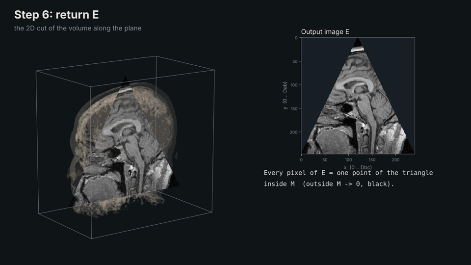

# I2SE-Ex1-plane-projection

[](https://github.com/maayancohen-coder/I2SE-Ex1-plane-projection/actions/workflows/tests.yml)

Plane projection of a 3D volume: extracting a 2D image from a 3D raster (NRRD) along an arbitrary plane,
and writing one video frame per plane.

- Course: Introduction to Software Engineering (OOP, OOD), Ex1.
- Authors: Maayan Cohen, Talya Elmaliah
- Status: complete

## Quick start

```
git clone https://github.com/maayancohen-coder/I2SE-Ex1-plane-projection.git
cd I2SE-Ex1-plane-projection
python -m venv .venv
.venv\Scripts\activate          # Windows
source .venv/bin/activate       # macOS / Linux
pip install -r requirements.txt
python Ex0.py data/MRHead.nrrd experiments/planes/MRHead.csv out.mp4
```

The NRRD files are not in the repository (see [Data](#data)); put them in `data/` first.
Tested on Windows 11, and on Ubuntu, Windows and macOS with GitHub Actions, Python 3.10 or newer.

## Explainer video

A 65-second walkthrough of the algorithm on the MRHead volume: the triangle `a, b, c`,
the unit vectors, the row-by-row sweep, the centring formula and why the triangle is isosceles.

[](docs/media/plane_projection_explainer.mp4)

Click the image to open the video ([docs/media/plane_projection_explainer.mp4](docs/media/plane_projection_explainer.mp4)).

## Problem

Given a 3D matrix `M` of size `sx * sy * sz` (unsigned 8, 16 or 32 bit values, `1 <= sx, sy, sz < 2^10`)
and a plane `p`, compute the 2D image `E` of the projection of `p` in `M`.

The plane is given by three points `a, b, c` forming an isosceles triangle (`|ab| = |ac|`),
or by four points forming an isosceles trapezoid. Every point inside the plane that lies inside `M`
is sampled into `E` (nearest voxel); points outside `M` get the value 0.

## Scope

In scope:
- Reading 3D volumes in NRRD format (raw and gzip encodings).
- Reading a list of planes from a CSV file and validating them.
- Projecting a plane given by 3 points (triangle) or 4 points (trapezoid).
- Writing the projected images as video frames, in the order of the CSV.
- Clear error messages for invalid input: missing or broken files stop the program;
  an invalid row or plane becomes an error frame (black, red X, line number and reason) and a warning.

Out of scope:
- A graphical user interface as the main way to run the program: the assignment's interface is the command line.
  An optional window (`gui.py`) was added on top of the same code, see [Graphical interface](#graphical-interface-optional).
- 3D rendering or display of the volume (use 3D Slicer for that).
- File formats other than NRRD (e.g. DICOM, NIfTI).
- Editing or writing volumes: the input file is read only.

## Constraints

| Constraint | Value | Source |
|------------|-------|--------|
| Volume size | `1 <= sx, sy, sz < 2^10` | Problem definition |
| Voxel values | unsigned 8, 16 or 32 bit | Problem definition |
| Performance | at least 30 fps on a `500^3` volume (target 100 fps) | Implementation requirements |
| Language | Python | Implementation requirements (Java, Python, C, C++) |
| Input format | NRRD | Data |
| Command line | `python Ex0.py file.nrrd file.csv file.mp4` | To Do, item 7 |

Note: the assignment specifies unsigned values, but the reference file `MRHead.nrrd` is signed 16 bit (`short`).
Signed 16-bit volumes are also supported; see [docs/SRS.md](docs/SRS.md).

## Usage

```
python Ex0.py file.nrrd file.csv file.mp4
```

- `file.nrrd`: a 3D volume in NRRD format.
- `file.csv`: a list of planes, one per line, `#` starts a comment:
  - triangle: 9 numbers `ax,ay,az,bx,by,bz,cx,cy,cz`
  - trapezoid: 12 numbers `a'x,a'y,a'z,a''x,a''y,a''z,bx,by,bz,cx,cy,cz`
  - full format and rules: [docs/SRS.md](docs/SRS.md), decision 10.
- `file.mp4`: the output video, one frame per plane, in the order of the CSV, 10 frames per second.

Example output (the times depend on the machine):

```
Loaded MRHead.nrrd: 256 x 256 x 130, int16 (0.09 s)
Projected 100 plane(s): average 3.02 ms per plane (331 fps)
Wrote out.mp4: 100 frames of 258 x 314 (0.61 s)
```

## Graphical interface (optional)

```
python gui.py
```
or, on Windows, double-click `run_gui.bat`.

- Choose the volume, the CSV file and the output, then **Run**: a progress bar, the frames as they are made,
  and afterwards a slider and **Play** to go over them; **Open video** opens the result.
- **Explore a plane**: choose a volume and move the sliders (axis, position, tilt, top edge).
  The projection is shown at once, as a triangle or, with a top edge above 0%, a trapezoid.
  **Copy** gives the plane as a CSV line.

The window runs exactly the same code as `Ex0.py` (`src/projection/pipeline.py`).

Ready-made plane files: `experiments/planes/` (100 planes per course volume) and `tests/data/`
(valid, invalid and edge cases).

## Running the tests

```
pytest                                   # the fast tests (no data files needed)
pytest -m slow                           # tests on MRHead and croissant in data/
pytest -m data -s                        # every NRRD file in data/: reading, correctness, speed, demo
pytest -m data -s --nrrd my.nrrd         # the same tests on your own volume (--nrrd can be repeated)
pytest -m data -s --nrrd my.nrrd --csv my.csv    # ... and run the demo on your own planes
```

The fast tests also run on every push on Windows, macOS and Linux (GitHub Actions, badge above).
The testing strategy is described in [docs/TESTING.md](docs/TESTING.md).

## Results

From [docs/EXPERIMENT.md](docs/EXPERIMENT.md) (Windows 11 laptop, 100 planes per volume):

| Volume | Size | Projection speed | Nearest vs trilinear (mean diff, 0-255) |
|--------|------|------------------|-----------------------------------------|
| MRHead | 256 x 256 x 130 | 507 fps | 3.10 |
| croissant | 500 x 500 x 500 | 52 fps | 2.35 |
| onion | 256 x 256 x 130 | 564 fps | 2.58 |

- The numpy version is 18–46 times faster than the plain loop version and gives exactly the same images.
- Nearest voxel looks almost the same as trilinear interpolation and is 2.5–4 times faster.
- Demo videos: [MRHead](docs/media/MRHead.mp4) · [onion](docs/media/onion.mp4) ·
  [croissant](docs/media/croissant.mp4) · [swiss_roll](docs/media/swiss_roll.mp4) ·
  [biscuit_cake](docs/media/biscuit_cake.mp4)

To repeat the experiment: `python experiments/run_experiment.py`

## Documentation

| Document | Content |
|----------|---------|
| [docs/SRS.md](docs/SRS.md) | requirements, inputs and outputs, and the 11 design decisions |
| [docs/ALGORITHM.md](docs/ALGORITHM.md) | the projection algorithm in pseudo-code, with our decisions |
| [docs/DESIGN.md](docs/DESIGN.md) | modules, classes, data flow and errors |
| [docs/TESTING.md](docs/TESTING.md) | testing strategy, test levels and requirement coverage |
| [docs/EXPERIMENT.md](docs/EXPERIMENT.md) | speed and sampling experiment, results and conclusions |
| [data/README.md](data/README.md) | the volumes and where to get them |

## Project structure

```
Ex0.py                  demo entry point (the command of the assignment)
gui.py, run_gui.bat     optional window
src/projection/         source code: nrrd_reader, plane, projector, video_writer, errors,
                        pipeline (shared by Ex0.py and gui.py), preview (GUI helpers)
tests/                  unit, integration and demo tests (pytest), test CSV files in tests/data/
experiments/            experiment script, plane files and raw results
docs/                   SRS, algorithm, design, testing, experiment, media (videos and images)
data/                   dataset description and phantom generator
.github/workflows/      GitHub Actions: tests on Windows, macOS and Linux
```

## Data

The NRRD files are not stored in the repository because of their size.
See [data/README.md](data/README.md) for the dataset and where to get each file.

## Acknowledgements

- Course dataset prepared by Aviya Cohen at the lecturer's request; `MRHead.nrrd` from the 3D Slicer sample data.
- An AI assistant (Claude, by Anthropic) was used for explanations, review, and drafting parts of the code
  and documentation. All decisions were discussed by the authors, and every change was reviewed, run and
  committed by them.

## License

See [LICENSE](LICENSE).
