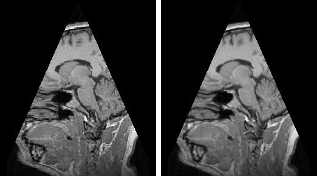
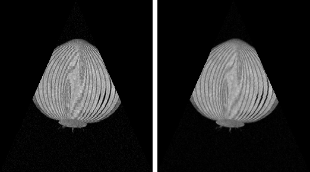
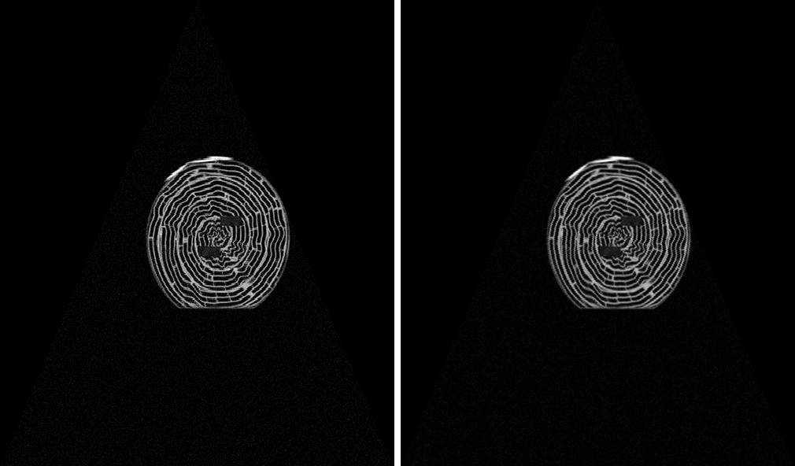
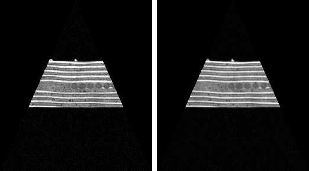
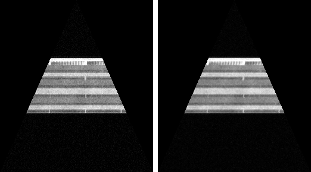

# Experiment

Two questions about the choices in the SRS:

1. **Speed (NFR-1):** is the projection fast enough for at least 30 planes per second, also on the largest volume (croissant, 500³)?
2. **Sampling (SRS decision 1):** we take the nearest voxel. How different would the images be with trilinear interpolation, and what would it cost?

## Setup

| | |
|---|---|
| Script | [`experiments/run_experiment.py`](../experiments/run_experiment.py) |
| Run | `python experiments/run_experiment.py` (all `.nrrd` files in `data/`) |
| Machine | Windows 11, Intel 12th generation laptop CPU (Intel64 Family 6 Model 154), Python 3.15.0, numpy 2.5.4 |
| Volumes | the five course volumes, see [`data/README.md`](../data/README.md) |
| Planes | 100 isosceles triangles per volume that sweep through the whole volume, tilting a little more each time. Saved in [`experiments/planes/`](../experiments/planes/), so the run can be repeated on the same planes |
| Raw results | [`experiments/results.md`](../experiments/results.md) |

What is measured, for each volume:

- **Fast fps:** `FastProjector` (numpy, the one `Ex0.py` uses) on all 100 planes, after one warm-up plane.
- **Reference fps:** `ReferenceProjector` (plain loops, a direct translation of [ALGORITHM.md](ALGORITHM.md)) on the first 3 planes, since it is slow.
- **Trilinear fps:** `TrilinearProjector`, which exists only in the experiment script. It visits exactly the same sample points as `FastProjector`, but each value is a weighted average of the 8 surrounding voxels instead of the nearest one.
- **Mean diff and PSNR:** both images are mapped to 0..255 with the same `Normalizer` as the video, then compared pixel by pixel over all 100 planes. PSNR above 30 dB is usually considered very close.
- **Ex0.py:** the demo video made with the required command `python Ex0.py file.nrrd file.csv file.mp4`, and the fps that `Ex0.py` printed.

## Results

| Volume | Size | Type | Fast fps | Reference fps | Speed-up | Trilinear fps | Mean diff (0-255) | PSNR (dB) | Ex0.py |
|---|---|---|---|---|---|---|---|---|---|
| biscuit_cake | 256x256x130 | uint16 | 295 | 12.86 | 23x | 113 | 1.83 | 34.9 | 404 fps |
| croissant | 500x500x500 | uint8 | 52 | 2.88 | 18x | 18 | 2.35 | 31.0 | 52 fps |
| MRHead | 256x256x130 | int16 | 507 | 12.70 | 40x | 140 | 3.10 | 31.5 | 331 fps |
| onion | 256x256x130 | uint8 | 564 | 12.29 | 46x | 134 | 2.58 | 32.5 | 336 fps |
| swiss_roll | 256x256x130 | uint32 | 533 | 12.57 | 42x | 119 | 2.54 | 31.2 | 340 fps |

### Nearest voxel (left) vs trilinear (right)

The plane at 30% of the sweep, from each volume.

| | |
|---|---|
| MRHead  | onion  |
| croissant  | swiss_roll  |
| biscuit_cake  | |

### Videos

The output of `Ex0.py` on the 100 sweep planes of each volume (10 seconds at 10 fps):
[MRHead](media/MRHead.mp4) ·
[onion](media/onion.mp4) ·
[croissant](media/croissant.mp4) ·
[swiss_roll](media/swiss_roll.mp4) ·
[biscuit_cake](media/biscuit_cake.mp4)

## Conclusions

1. **NFR-1 is met on every volume.** The slowest case is croissant (500³) at 52 fps, still above 30. On the 256x256x130 volumes the projection runs at about 300–560 fps.
2. **Vectorising was necessary.** The loop version reaches only about 12.5 fps on the small volumes and 2.9 fps on croissant, so it would fail NFR-1. The numpy version computes the same image (checked bit for bit in the tests, [TESTING.md](TESTING.md) level 3) 18–46 times faster.
3. **The cost depends mainly on the size of the plane.** Each pixel of E is one sample. Croissant's planes have about 4–5 times more pixels than those of the 256 volumes, and the fps drops 6–10 times. The rest of the difference is probably memory access: croissant is 125 MB, so the samples rarely hit the CPU cache.
4. **Nearest voxel is a good choice (SRS decision 1).** The trilinear images differ by only 1.8–3.1 grey levels out of 255 on average (PSNR 31–35 dB). In the side-by-side images the anatomy and the structures look the same. Nearest voxel is also 2.5–4 times faster and never creates values that are not in the volume.
5. **What trilinear does better.** On fine, repeating structures (the onion layers and the croissant layers) nearest voxel shows small steps and a moiré pattern, and trilinear is smoother. If image quality mattered more than speed, trilinear would still pass NFR-1 on the 256 volumes (113–140 fps), but not on croissant (18 fps).
6. **The numbers vary between runs.** Timing on a laptop depends on what else is running and on power settings. In the data tests on the same machine croissant reached about 119 fps (TESTING.md, level 7). The fps that `Ex0.py` prints is lower than "Fast fps" on the small volumes, because `Ex0.py` has no warm-up plane and also counts the first, slower call. The conclusions above do not depend on these differences.
